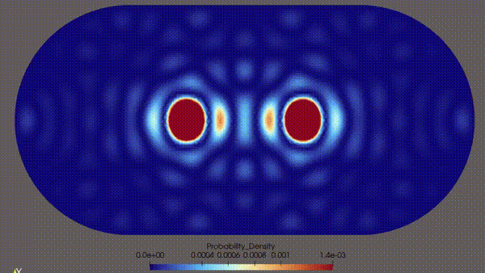
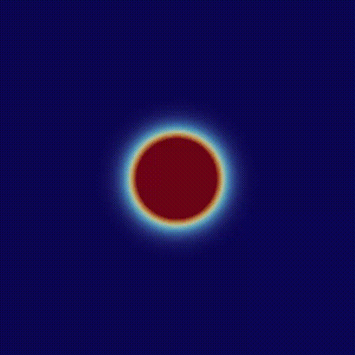
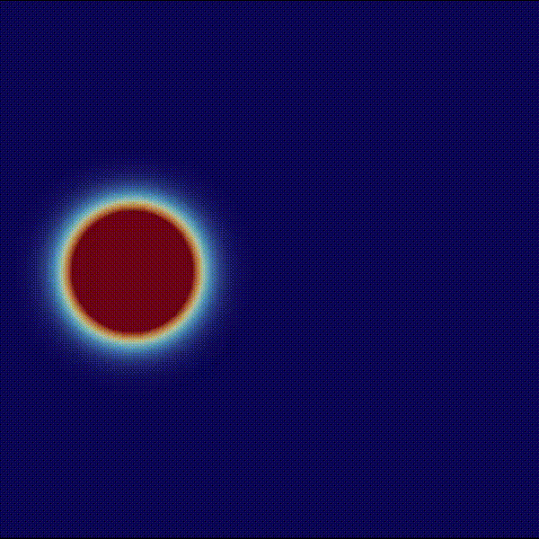
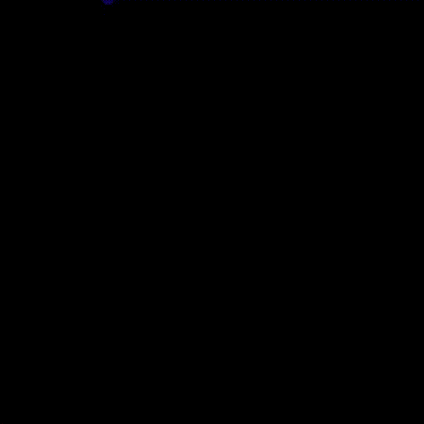

# FEniCS4Schroedinger

An FEM-based simulation using **FEniCSx**, **SLEPc**, and **PETSc** to investigate the quantum dynamics of a 2D wavepacket. This project explores Lieb-Robinson bounds in the context of a particle in a 2D box with fixed boundary conditions. 

## Quantum Stadium



## Particle in 2D Box
When a localized Gaussian wavepacket is initialized at the exact center of a hard-wall square domain ($V=0$, Homogeneous Dirichlet boundaries), it expands as an isotropic ring. Upon impacting all four walls simultaneously, symmetric reflections interfere constructively to form a sharp, quantized $3 \times 3$ grid pattern of probability density hot-spots.



## Lieb-Robinson Bounds for particle in 2D Box
By breaking geometric symmetry (placing the initial wavepacket off-center at $x_0 = -L/4$), we isolate a clear, directional wavefront corridor. To verify the **Lieb-Robinson Speed Limit ($v_{LR}$)**, the simulation uses a dynamic visibility threshold mask (left video) alongside a twin boundary-contour tracker (right video). Information is strictly prohibited from leaking beyond the linear expanding light cone wall, except for a minor exponentially suppressed tail.

 


## Requirements & Installation

This project is built to run smoothly inside a **Linux/WSL2** environment

### Dependencies
* Python 3.10+
* FEniCSx (`dolfinx`)
* `mpi4py`, `petsc4py`, `slepc4py`
* `numpy`, `matplotlib`

### Verify the stack is working
    python -c "import dolfinx, gmsh, petsc4py, mpi4py; print('FEniCSx stack ok')"

### Recommended Setup via Conda
The most reliable method to install the underlying C-libraries (PETSc/SLEPc/DOLFINx) alongside Python is via `conda-forge`:

### Create a dedicated environment with the FEniCSx stack
conda create -n fenics-env -c conda-forge python=3.10 dolfinx mpich petsc4py slepc4py matplotlib numpy

## Structure
```text
FEniCS4Schroedinger/
├── src/
│   ├── __init__.py
│   ├── mesh.py                             # Handles square mesh generation and facet tagging
│   ├── solver.py                           # FEniCSx Matrix assembly & SLEPc eigenproblem engine 
│   └── lieb_robinson.py                    # Light-cone extraction, polyfitting, and 1D profiling
├── scripts/
│   ├── __init__.py
│   ├── main.py                             # Runs the solver with a 2D square mesh with a spectral based time evolution
│   ├── run_convergence.py                  # Runs the convergence study with 4 different meshes
│   ├── run_lieb_robinson_study.py          # Runs the solver and also lieb_robinson.py extracting the light-cone
│   ├── run_verification_time_evolution.py  # Runs the verification of the time evolution comparing the numerical results to the analytical solution
│   └── run_verification.py                 # Runs the verification of the solver comparing the numerical results to the analytical solution
├── media/                                  # Animation from paraview
├── results/                                # Post-processed plots (.png) and ParaView streams (.pvd / .xmdf)
├── report/                                 # Short report of the project
└── README.md
```

## Usage

### Main Time Evolution 

```bash
# Quick default run (Square domain, single wavepacket)
python3 scripts/main.py

# Run a circular domain configuration with a fine mesh and custom eigenvalue resolution
python3 scripts/main.py --mesh_type circle --radius 5.0 --target_h 0.12 --nev 200

# Run a high-energy dual-wavepacket collision inside a chaotic Bunimovich Stadium
python3 scripts/main.py --mesh_type stadium --num_packets 2 -L 6.0 --radius 3.0  --nev 250

### Run Lieb Robinson for a particle in a 2D box 
python3 -m scripts.run_lieb_robinson_study
```

### Verify solver
```bash
# Eigenvalue FEM: 
python3 -m scripts.run_verification

#Time Evolution: 
python3 -m scripts.run_verification_time_evolution
```

### Convergence study
```bash
python3 -m scripts.run_convergenc
```

### The results
| Simulation Run  | Generation Script | Target Output Directory | What is saved |
| :--- | :--- | :--- | :--- | 
| Symmetric Particle in a box | main.py | eigenstates and particle_in_box_time_evol | The eigenstates are given as xdmf files and the particle_in_box_time is intended to be viewed as a pvd | 
| Lieb-Robinson Study | run_lieb_robinson_study.py | lieb_robinson and wavepacket | In Lieb_Robinson/ three matplotlib plots are saved and in wavepacket/ there is a pvd file for the time evolution but also for the lieb-robinson light cone evolution in time. | 
| Verfication eigenvalue solver | run_verification.py | verification | Saves a matplotlib plot  | 
| Verfication time evolution | run_verification_time_evolution.py | time_verification | Saves a matplotlib plot  |
| Convergenve study | run_convergence.py | convergence | Saves a matplotlib plot  |

Visualizsation of results can either be a matplotlib plot or xdmf / pvd files that can be viewed in paraview. For the pvd files in paraview select probability_density.


## Authors and acknowledgment
Felicia Erb

Special thanks to the FEniCSx and SLEPc development communities and to the MSSD Lecturers: Dr. Lambert Theisen and Dr. Georgii Oblapenko.

## License
This project is licensed under the MIT License - see the LICENSE file for details.


