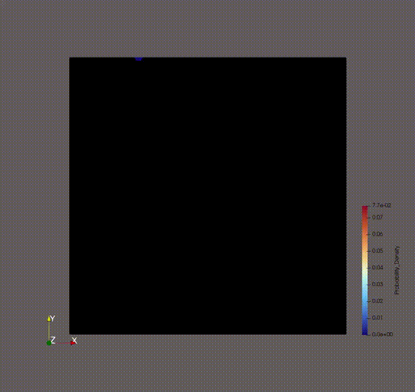
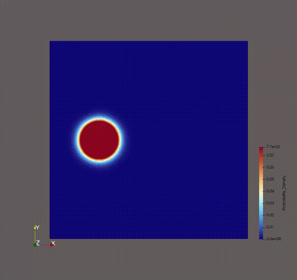
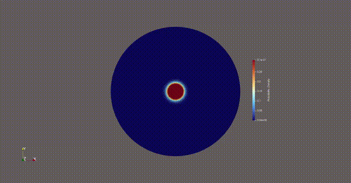
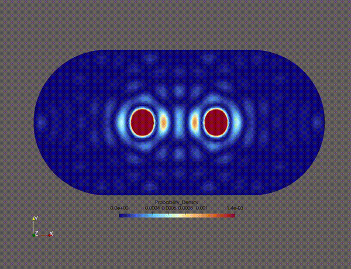

# Different Mesh Types Explained

## Square
Quick default run (Square domain, single wavepacket)
```bash
python3 -m scripts.main --mesh_type square 
```


## Lieb-Robinson Bounds
Compute Lieb-Robinson bounds for square domain with offset wavepacket

```bash
python3 -m scripts.run_lieb_robinson_study 
```
 


## Circle

Run a circular domain configuration 
```bash
python3 -m scripts.main --mesh_type circular
```



## Stadium

Run a high-energy dual-wavepacket collision inside a chaotic Bunimovich Stadium
```bash
python3 -m scripts.main --mesh_type stadium --num_packets 2 --T 10.0 --frames 500 
```

