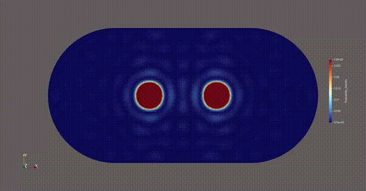

# Different Mesh Types Explained

## Square
Quick default run (Square domain, single wavepacket)
```bash
python3 -m scripts.main --mesh_type square --num_packets 1 -L 10.0 -N 60 
```


## Circle

Run a circular domain configuration 
```bash
python3 -m scripts.main --mesh_type circle --radius 5.0 --target_h 0.12 --nev 200
```


## Stadium

Run a high-energy dual-wavepacket collision inside a chaotic Bunimovich Stadium
```bash
python3 -m scripts.main --mesh_type stadium --num_packets 2 -L 6.0 --radius 3.0  --nev 250
```

