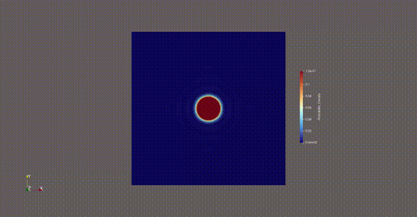
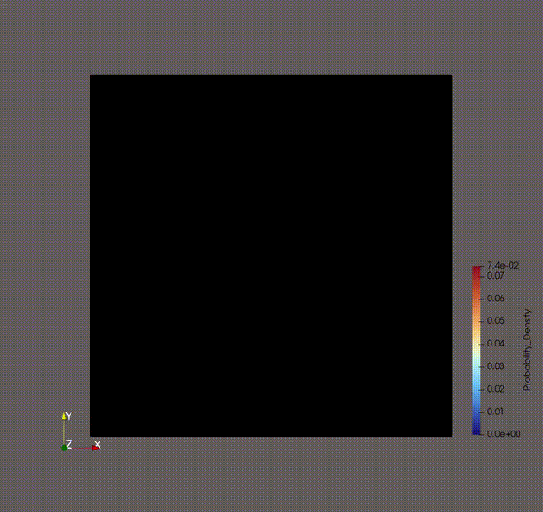
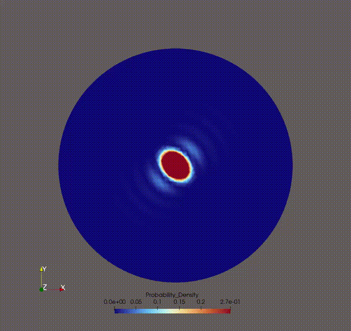
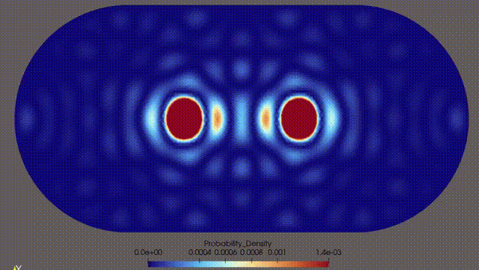

# Different Mesh Types Explained

## Square
Quick default run (Square domain, single wavepacket)
```bash
python3 -m scripts.main --mesh_type square 
```



## Lieb-Robinson Bounds
Compute Lieb-Robinson bounds for square domain with differnt wavepackets for a standard square domain of L = 10.0

```bash
python3 -m scripts.run_lieb_robinson_study 
```

### Wavepacket at center left (x0 = -2.5)
 

### Wavepacket at center  (x0 = 0.0)

### Wavepacket near-wall (x0 = -4.0)


Quantitative Proximity ComparisonBelow are the empirically extracted wavefront parameters across the different spatial placement variants ($\sigma=0.5, L=10, N=40, n_{\text{ev}}=150$):

| Placement $x_0$ | Left Wall Distance | Measured $v_{\text{LR}}$ | Decay Const. $\mu$ | Physical Regime |
| --- | --- | --- | --- | --- |
| **0.00 (Center)** | 5.00 | $\sim 0.25$ | $\sim 0.61$ | Unobstructed Propagation |
| **-2.50 (Center-Left)** | 2.50 | $\sim 0.39$ | $\sim 0.57$ | Transitional Expansion |
| **-4.00 (Near-Wall)** | 1.00 | $\sim 0.61$ | $\sim 1.29$ | Strong Reflection Contamination |

**Note: The metrics are subject to numerical tracking distortion due to immediate phase-inverted backscattering from the Dirichlet boundary.* <br>
**Note 2: The location of the wavepacket is currently still hardcoded so it needs to be changed manually in lieb_robinson.py. Sorry :(*

## Circle

Run a circular domain configuration 
```bash
python3 -m scripts.main --mesh_type circular
```



## Stadium

Run a high-energy dual-wavepacket collision inside a chaotic Bunimovich Stadium
```bash
python3 -m scripts.main --mesh_type stadium --num_packets 2 --T 10.0 --frames 500 
```

